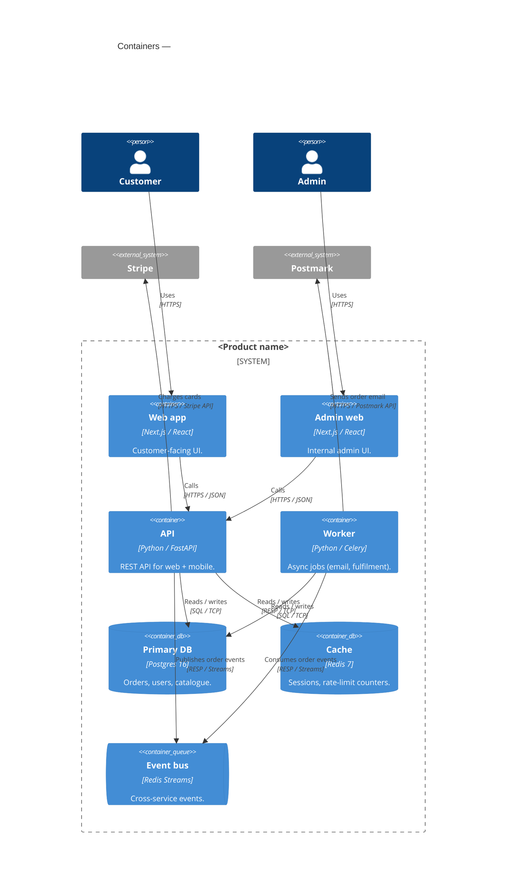

# Architecture — Containers (C4 Level 2)

Zoom into `<Product name>` from the [System Context](./context.md). Each box below is an independently-runnable unit (a service, app, datastore, or message broker). The C4 use of "container" predates Docker — it doesn't mean Docker container specifically.

## Containers

- **Web app (Next.js)** — customer-facing UI. Server-rendered pages + client islands. Talks only to the API.
- **Admin web (Next.js)** — separate UI for internal admins. Auth gated.
- **API (FastAPI)** — REST API consumed by the web + mobile clients. Owns business logic.
- **Worker (Celery)** — async job runner. Drains the event bus and the delayed-job queue.
- **Primary DB (Postgres 16)** — source of truth for orders, users, catalogue.
- **Cache (Redis 7)** — session store, rate-limit counters, hot lookups.
- **Event bus (Redis Streams)** — cross-service event transport ([ADR-0002](../../decisions/0002-event-bus-on-redis-streams.md)).

## Notable flows

- **Customer order:** Web → API → DB (write order, status=pending) → Bus (`order.created`) → Worker → Stripe (charge) → DB (status=paid) → Bus (`order.paid`) → Worker → Postmark (confirmation email).
- **Admin update:** Admin Web → API → DB.

## What's next

- [Components (C4 L3)](./components/) — zoom into a specific container.
- [Decisions](../../decisions/README.md) — why we chose Postgres, Redis Streams, etc.

## Maintenance

- **Last verified:** YYYY-MM-DD by @name.
- **When to update:** any time a container is added, removed, or its protocol / responsibility changes materially.
