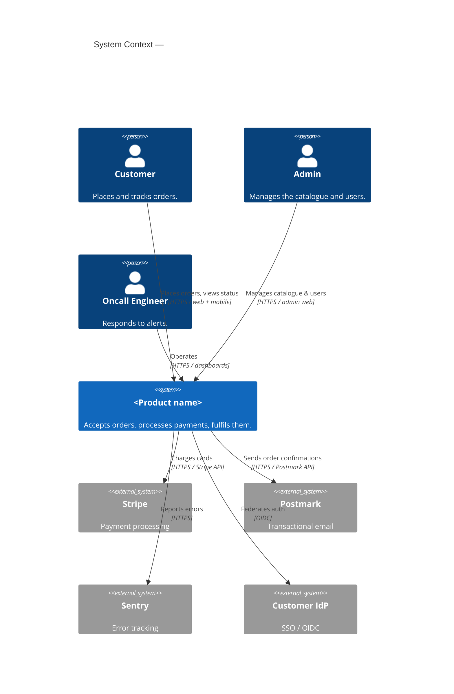

# Architecture — System Context (C4 Level 1)

<One paragraph: what the system does at the highest level. The reader of this
diagram is anyone in the company — not necessarily an engineer.>

## Persons

- **Customer** — end users who place orders.
- **Admin** — internal staff managing the catalogue and accounts.
- **Oncall Engineer** — operations role; reads dashboards, responds to alerts.

## External systems

- **Stripe** — handles all card processing. We never store PANs.
- **Postmark** — delivery of transactional email (order confirmations, password resets).
- **Sentry** — error tracking from the API, web, and mobile clients.
- **Customer IdP** — SSO for enterprise customers via OIDC.

## What's next

- [Containers (C4 L2)](./containers.md) — zoom in on what's inside `<Product name>`.

## Maintenance

- **Last verified:** YYYY-MM-DD by @name.
- **When to update:** any time a new external system is added or removed, or a new persona is introduced.
