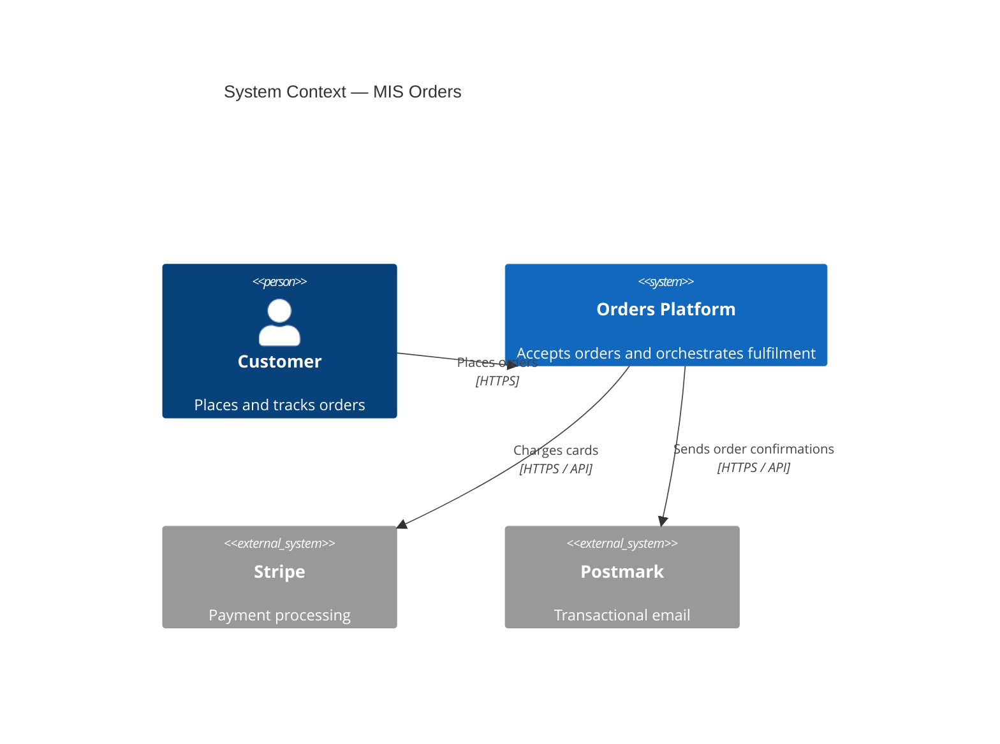

# C4 model — architecture diagrams

The MIS architecture diagramming standard is the [**C4 model**](https://c4model.com/). It's a four-level zoom-in: System Context → Containers → Components → Code. MIS uses the first three. Level 4 (Code) is replaced by reading the code.

## The levels

| Level | Name              | Shows                                                       | Audience               |
|-------|-------------------|-------------------------------------------------------------|------------------------|
| 1     | System Context    | Your system as a single box, users + external systems       | Everyone (PMs, eng, leadership) |
| 2     | Containers        | The independently-runnable units: apps, services, DBs, queues | Engineering across teams |
| 3     | Components        | Major modules inside one container                          | Engineers on that container |
| 4     | Code              | Class diagrams; mostly skip                                  | (skip)                 |

Plus two supplementary diagram types:

- **Dynamic diagrams** — sequence / flow for a specific scenario (auth flow, order checkout flow). Cite the level they sit at (usually L2 or L3).
- **Deployment diagrams** — same containers as L2, but mapped to infrastructure (VPC, regions, clusters).

## Terminology — read this first

- **"Container" in C4 is not "Docker container".** In C4 it means any independently-runnable unit — a web app, an API service, a database, a queue, a Lambda function. The terminology predates Docker. Things that *happen* to be Docker containers are C4 containers; things that aren't (a managed RDS instance, an SQS queue) are also C4 containers.
- **"Component" is *not* "React component".** It's a major module inside a container — a package, a layer, a subsystem.
- **"Person"** = a human user role (Customer, Admin, Oncall Engineer). Not a specific human.
- **"External system"** = a system you don't own (Stripe, Sentry, the customer's IdP).

## Per-level rules

### Level 1 — System Context

One box for your system. Around it: persons and external systems. Lines show "uses" relationships with verbs and protocols.

**What to include:**

- Your system, as **one** box, named after the product.
- Every distinct **role** of human user.
- Every **external system** you talk to (or that talks to you).

**What to leave out:**

- Anything inside your system.
- Implementation detail (HTTP vs gRPC at this level is fine; library versions are not).

**File:** `docs/architecture/c4/context.md`. One diagram. Prose around it explains who the persons are and what the external systems do for you. Template: `assets/template-c4-context.md`.

### Level 2 — Containers

Zoom into the single box from L1. Show the apps, services, datastores, and message brokers — anything independently runnable.

**What to include:**

- Each **service** / **app** / **worker** as a container.
- Each **datastore** (Postgres, Redis, S3) as a container.
- Each **message broker / queue** (Kafka, SQS) as a container.
- The **external systems** from L1 (same boxes, redrawn at this level).
- Annotated lines: protocol (HTTPS / gRPC / SQL), purpose, sync vs async.

**What to leave out:**

- Code internals — that's L3.
- Deployment topology — that's a deployment diagram (similar shape, different overlay).

**File:** `docs/architecture/c4/containers.md`. One diagram. Prose around it explains each container's responsibility in 1–2 sentences. Template: `assets/template-c4-container.md`.

### Level 3 — Components

Zoom into **one** container from L2. Show its major modules.

- Only draw L3 for containers complex enough to warrant it (typically the main API and any service with non-trivial routing).
- A monolithic app might have one L3 diagram; a 200-LOC Lambda doesn't need one.

**File:** `docs/architecture/c4/components/<container>.md`. One file per container that has an L3 diagram.

### Level 4 — Code

Skip. Read the code.

## Tooling

### Mermaid (default)

GitHub renders Mermaid C4 syntax natively. Use it for diagrams checked into the repo.

Available C4 Mermaid blocks: `C4Context`, `C4Container`, `C4Component`, `C4Dynamic`, `C4Deployment`.

### Structurizr DSL (optional, for repos that need it)

[Structurizr DSL](https://structurizr.com/dsl) is the canonical C4 toolchain — one workspace, all levels in one file, multiple rendered views.

Use when:

- You have > 5 containers and need consistency across L1 / L2 / L3.
- You want generated docs to render in Structurizr Lite or the cloud workspace.
- The diagrams are evolving fast and the team wants `git diff` on architecture changes.

Don't use when:

- You have one or two diagrams. Mermaid is lighter.

If a repo uses Structurizr, the `workspace.dsl` is the source of truth and the Markdown files reference rendered views.

## Annotation rules

Every line / box answers:

- **Box:** What is it? What protocol does it speak? Where does it run?
- **Line:** What does it do? Synchronously or asynchronously? Over what protocol?

Bad: `Service A → Service B`.  
Good: `Service A → Service B  [POST /orders, sync, JSON over HTTPS]`.

## Update discipline

- **Architecture diagrams are part of the change.** A PR that adds a new service or message bus updates the relevant diagrams in the **same PR**, or it doesn't merge.
- **Diagrams have a `last verified` date** in the prose around them. Re-verify quarterly.
- **Stale diagrams are worse than missing ones** — they confidently lie. If a diagram is wrong and you don't have time to fix it, delete it and replace with a TODO.

## Where the diagrams sit relative to other docs

- A C4 diagram is **architectural**. It pairs naturally with **ADRs** ("we use Postgres" — show Postgres on the L2 diagram).
- A C4 diagram is **not Explanation** in the Diataxis sense, though an Explanation doc may embed one to illustrate.
- A C4 diagram is **not a runbook**. Runbooks reference the diagram to orient the reader; they don't include it.

## Anti-patterns

- One mega-diagram with every box at every level. Pick a level.
- Boxes without annotations. A reader can't tell HTTP from gRPC by squinting.
- "Service A → Service B" with no verb. What does A want from B?
- Diagrams as PNGs with no source. Use Mermaid (or commit the Structurizr DSL).
- Skipping L1 because "everyone knows what the system does". They don't, and onboarding takes longer because of it.
- Drawing L3 for every container. L3 is per-container, on demand.
- Calling C4 containers "Docker containers" in prose. Confusing and wrong.
