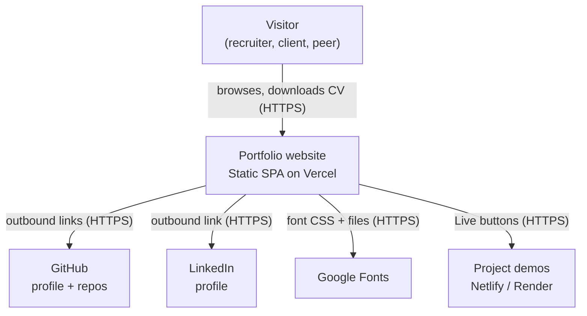

# Architecture — System Context (C4 Level 1)

The portfolio is a static website that presents Ahmed Elbialy's profile, experience, skills and projects to recruiters, hiring managers and potential clients. It has no backend, database or authentication. Every outbound interaction is a plain link to an external service.

## Diagram

```
           ┌──────────────────────────────┐
           │  Visitor                     │
           │  (recruiter, hiring manager, │
           │   client, peer)              │
           └──────────────┬───────────────┘
                          │ browses, downloads CV
                          │ HTTPS
                          ▼
           ┌──────────────────────────────┐
           │  Portfolio website           │
           │  Static SPA on Vercel.       │
           │  Profile, experience,        │
           │  skills, projects, CV.       │
           └──┬─────────┬─────────┬───────┘
              │ links   │ links   │ loads fonts
              │ HTTPS   │ HTTPS   │ HTTPS
              ▼         ▼         ▼
     ┌──────────┐ ┌──────────┐ ┌──────────────┐
     │  GitHub  │ │ LinkedIn │ │ Google Fonts │
     │ profile, │ │ profile  │ │ Space Grotesk│
     │ repos    │ │          │ │ JetBrains    │
     └──────────┘ └──────────┘ └──────────────┘
              │
              │ "Live" buttons link out (HTTPS)
              ▼
     ┌─────────────────────────────────────┐
     │  Project demos                      │
     │  Netlify (*.netlify.app), Render    │
     └─────────────────────────────────────┘

     Email (mailto:) and phone (tel:) links open the visitor's own apps.
```



## Notes

- Google Fonts is the only third-party resource loaded at runtime. Everything else is an outbound link.
- There's no analytics, contact form or API, so nothing collects visitor data.
