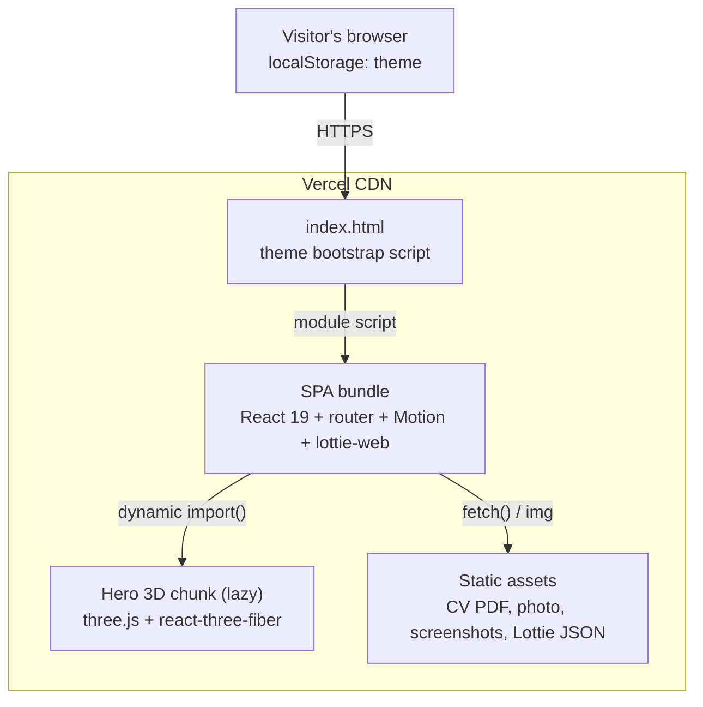

# Architecture — Containers (C4 Level 2)

The system has one runnable unit: a client-side React application built by Vite into static files and served from Vercel's CDN. Everything else is static assets served next to it.

## Diagram

```
  ┌──────────────────────────────────────────────────────────────────┐
  │  Vercel CDN (static hosting)                                     │
  │                                                                  │
  │  ┌────────────────────────┐      ┌─────────────────────────────┐ │
  │  │ index.html             │      │ Static assets (public/)     │ │
  │  │ theme bootstrap script │      │  /Ahmed_Adel_CV.pdf         │ │
  │  └───────────┬────────────┘      │  /assets/profile-cutout.webp │ │
  │              │ module script    │  /assets/projects/*.png     │ │
  │              ▼                   │  /assets/lotties/*.json     │ │
  │  ┌────────────────────────┐      └──────────────▲──────────────┘ │
  │  │ SPA bundle (JS + CSS)  │                     │                │
  │  │ React 19, router,      │── fetch() Lottie ───┤                │
  │  │ Motion, lottie-web     │──  screenshots ┘                │
  │  │ ~854 kB min / 245 kB gz│                                      │
  │  └───────────┬────────────┘                                      │
  │              │ dynamic import() (only if motion is allowed)      │
  │              ▼                                                   │
  │  ┌────────────────────────┐                                      │
  │  │ Hero 3D chunk          │                                      │
  │  │ three.js + r3f + drei  │                                      │
  │  │ ~908 kB min / 245 kB gz│                                      │
  │  └────────────────────────┘                                      │
  └──────────────────────────────────────────────────────────────────┘
               ▲
               │ HTTPS
          Visitor's browser  ── localStorage["theme"] (light | dark)
```



## Containers

| Container       | Technology                          | Responsibility                                            |
| --------------- | ----------------------------------- | --------------------------------------------------------- |
| `index.html`    | HTML + inline script                | Sets `data-theme` before paint, loads fonts and the bundle |
| SPA bundle      | React 19, react-router 7, Motion    | Renders all routes and sections from `site-data.ts`        |
| Hero 3D chunk   | three.js, @react-three/fiber, drei  | Rotating wireframe icosahedron behind the hero Lottie     |
| Static assets   | Files in `public/`                  | CV, profile photo, project screenshots, Lottie animations |

Sizes are from `npm run build` on 2026-11-05. For the internal module layout, see [Layering with Feature-Sliced Design](../fsd-layers.md).
